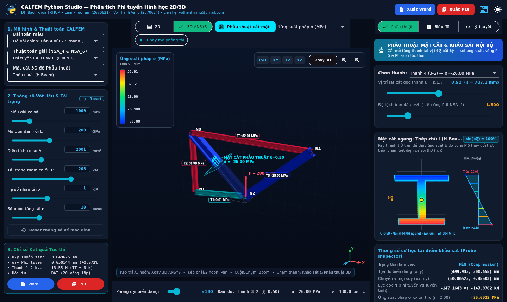

# Phân Tích Phi Tuyến Hình Học Hệ Dàn Phẳng Bằng CALFEM (Python 2D/3D)

> **Tiểu luận môn Phân tích Phi tuyến Kết cấu**  
> **Trường Đại học Bách Khoa – ĐHQG TP. Hồ Chí Minh** | Khoa Kỹ thuật Xây dựng – Bộ môn Công trình  
> **Giảng viên hướng dẫn:** PGS.TS. Ngô Hữu Cường  
> **Học viên thực hiện:** Lâm Phúc Tâm (`2670621`) - Võ Thanh Vang (`2670624`) | **Liên hệ:** `vothanhvang@gmail.com`

[](https://vothanhvang.github.io/PhanTichPhiTuyen_BaiTieuLuan4/)
[-2563EB?style=for-the-badge)](releases/PhanTichPhiTuyen_CALFEM_Windows_x64.exe)
[](releases/PhanTichPhiTuyen_CALFEM_Android_arm64.apk)

---

## 1. Trải nghiệm Trực tiếp Chương trình ngay trên GitHub

Mở trực tiếp ứng dụng mô phỏng **2D & 3D trực quan** (có xoay/pan/zoom 3D, **Phẫu thuật mặt cắt ngang/dọc**, nhập số trực tiếp + Reset mặc định, so sánh 4 mô hình CALFEM & 6 thuật toán giải `NSA_6`, và **xuất Thuyết minh Word `.docx` / Báo cáo PDF `.pdf`** kèm hộp thoại chọn nơi lưu ngay trên trình duyệt):

- **Ứng dụng Web trực tuyến (GitHub Pages):** https://vothanhvang.github.io/PhanTichPhiTuyen_BaiTieuLuan4/
- **File cài đặt / chạy trực tiếp:**
  - **Windows x64 (bất kỳ PC Windows nào):** [`releases/PhanTichPhiTuyen_CALFEM_Windows_x64.exe`](releases/PhanTichPhiTuyen_CALFEM_Windows_x64.exe) *(nhấp đúp chạy ngay, không cần cài Python)*
  - **Android ARM64 (Máy tính bảng & Điện thoại):** [`releases/PhanTichPhiTuyen_CALFEM_Android_arm64.apk`](releases/PhanTichPhiTuyen_CALFEM_Android_arm64.apk)



---

## 2. Tài liệu Báo cáo Tiểu luận (Word, PDF, PowerPoint)

| Loại tài liệu | Tên tệp | Nội dung chính |
|---|---|---|
| **Thuyết minh Word** | [`ThuyetMinh_PhanTichPhiTuyenHinhHoc_CALFEM.docx`](ThuyetMinh_PhanTichPhiTuyenHinhHoc_CALFEM.docx) | Đầy đủ công thức Word OMML chỉnh sửa được, dẫn nguồn số trang sách & PDF, tóm tắt 7 công thức Toán học + Cơ học trước khi giải, lời giải từng bước, 5 bản chất vật lý và kiến trúc phần mềm Python 2D/3D. |
| **Thuyết minh PDF** | [`ThuyetMinh_PhanTichPhiTuyenHinhHoc_CALFEM.pdf`](ThuyetMinh_PhanTichPhiTuyenHinhHoc_CALFEM.pdf) | Bản PDF xuất trực tiếp từ Microsoft Word, sẵn sàng in ấn & nộp bài. |
| **Slide PowerPoint** | [`BaoCao_PhanTichPhiTuyenHinhHoc_CALFEM.pptx`](BaoCao_PhanTichPhiTuyenHinhHoc_CALFEM.pptx) | 22 slide 16:9 hiện đại phục vụ báo cáo tiểu luận trước lớp và Thầy hướng dẫn. |
| **Slide PDF** | [`BaoCao_PhanTichPhiTuyenHinhHoc_CALFEM.pdf`](BaoCao_PhanTichPhiTuyenHinhHoc_CALFEM.pdf) | Bản PDF của bộ slide trình chiếu. |

---

## 3. Tóm tắt Kết quả Khoa học & 5 Phát hiện Bản chất Vật lý (Đề bài Dàn 4 nút – 5 thanh, $P = 208\text{ kN}$)

- **Thông số đề bài:** $L = 1000\text{ mm}$, $E = 200\text{ GPa}$, $A = 2001\text{ mm}^2$, diện tích hai thanh chéo $= 2\sqrt{2}A$, tải $P = 208\text{ kN}$ hướng **lên (+Y)** tại Nút 2.
- **Kiểm chứng tuyệt đối:**
  - Khớp 100% **Dahlblom (2016) Example 9.1** (`tr. 260–261`) từng chữ số cả 6 vòng lặp `bar2g` (`a5 = -44.544 mm`, `a6 = -108.835 mm`, `Q1 = -11.1360 MN`, `Q2 = +1.4833 MN`).
  - Khớp **CALFEM 3.4 `exs3.m`**, nghiệm giải tích và **SAP2000** (sai số tuyến tính $< 10^{-16}\text{ mm}$).
  - Sai số ma trận tiếp tuyến giải tích so với sai phân trung tâm: **$3.47 \times 10^{-13}$**.

| Mô hình phân tích | $u_{2y}$ (mm) | Lệch vs TT | Lực thanh 1–2, $N_{12}$ (N) | Phản lực $R_{1y}$ (kN) | Phản lực $R_{4y}$ (kN) |
|---|---:|---:|---:|---:|---:|
| 1. Đàn hồi Tuyến tính (`bar2e` / SAP2000) | `0.649675` | `0.000%` | `0.0000` *(không lực)* | `-104.0000` | `-104.0000` |
| 2. CALFEM `bar2g` Bậc 2 gốc (Dahlblom Ch. 9) | `0.649988` | `+0.048%` | `+13.5238` *(hồi sinh!)* | `-104.0203` | `-103.9797` |
| 3. Corotational UL (`bar2g` cập nhật + Full NR) | `0.650144` | `+0.072%` | `+13.5524` *(hồi sinh!)* | `-104.0203` | `-103.9797` |
| 4. Total Lagrangian Green-Lagrange (`NSA_4`) | `0.650043` | `+0.057%` | `+13.5471` *(hồi sinh!)* | `-104.0203` | `-103.9797` |

**5 Bản chất Cơ học nổi bật:**
1. **Thanh không lực 1–2 "hồi sinh"** mang lực kéo ($N_{12} = +13.55\text{ N}$ tại $1P$, lên $+180.39\text{ kN}$ tại $100P$) do định lý Py-ta-go và cân bằng xoay của thanh 1–3.
2. **Bất đối xứng phản lực gối** ($|R_{1y}| > |R_{4y}|$ chênh $40.57\text{ N}$) theo quy tắc đòn bẩy cấu hình biến dạng $R_{4y}(2L+u_{4x}) + P(L+u_{2x}) = 0$.
3. **Bất đối xứng Mềm hóa (+P hướng lên) vs Cứng hóa (−P hướng xuống)** do dấu lực dọc trong ma trận độ cứng hình học $[k_g]$.
4. **Độ nhạy tải lớn ($1P \to 500P$):** Sai lệch tăng từ $+0.072\%$ ($1P$) lên $+8.28\%$ ($100P$), $+27.81\%$ ($250P$) và $+303.27\%$ ($500P$, đã bật nhảy).
5. **Phát hiện Bật nhảy Snap-Through thực thụ** của chính dàn 5 thanh tại $P_{\text{lim}} = 78.45\text{ MN}$ ($u_{2y} = 480\text{ mm}$) — **thấp hơn 4.41 lần** so với tải trị riêng tuyến tính hóa $P_{cr} = 346.00\text{ MN}$!

---

## 4. Cấu trúc Mã nguồn & Hướng dẫn Chạy Cục bộ

```text
BaiTapTieuLuan/
├── python_core/                # Lõi tính toán Python (chú thích tiếng Việt đầy đủ)
│   ├── calfem_elements.py      # bar2e, bar2g, bar2s, assem, solveq, extract, Corotational UL, Total Lagrangian
│   ├── truss_models.py         # Đề bài 5 thanh, Dahlblom Ex 9.1, CALFEM exs3, Von Mises Arch, Tiết diện 3D
│   ├── nonlinear_solvers.py    # 6 thuật toán giải NSA_6 + Buckling trị riêng + Kiểm chứng tiếp tuyến
│   ├── probe_dissection.py     # Khảo sát bất kỳ vị trí (e, ξ, η, ζ) & Phẫu thuật mặt cắt ngang/dọc
│   ├── report_exporter.py      # Xuất tự động Word (.docx) & PDF (.pdf)
│   ├── api_server.py           # HTTP JSON Server phục vụ chế độ chạy độc lập trên Windows
│   ├── run_full_analysis.py    # Chạy toàn bộ phân tích & xuất 8 biểu đồ 300 DPI
│   └── test_verification.py    # Bộ kiểm thử tự động 6 trụ cột khoa học
├── results/                    # Kết quả JSON, CSV và biểu đồ 300 DPI
├── scripts/                    # Script tạo thuyết minh Word OMML, PowerPoint 22 slide & đóng gói .exe
├── releases/                   # File chạy sẵn Windows .exe và Android .apk
└── docs/                       # Bản dựng Web triển khai trực tiếp trên GitHub Pages
```

### Chạy lõi Python & Kiểm thử tự động
```bash
python -m venv .venv
.venv\Scripts\pip install -r requirements.txt
.venv\Scripts\python -m python_core.test_verification
.venv\Scripts\python -m python_core.run_full_analysis
```
